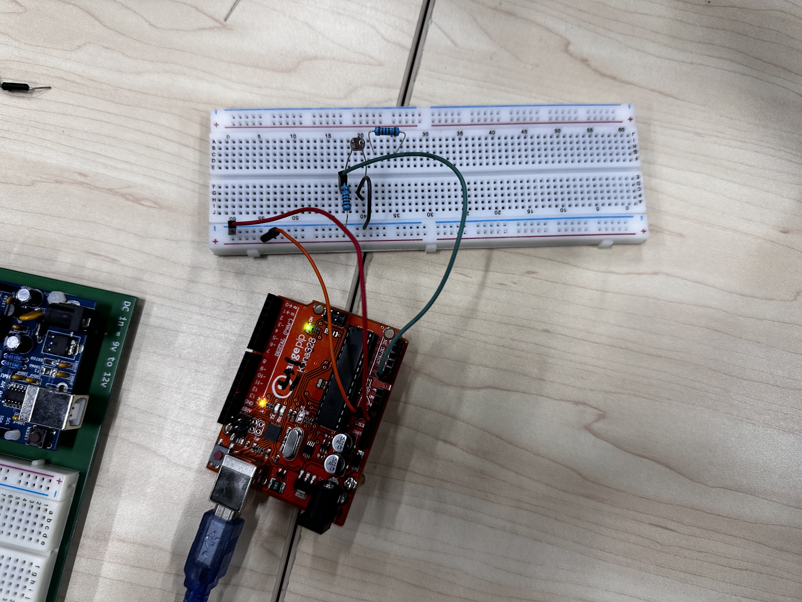
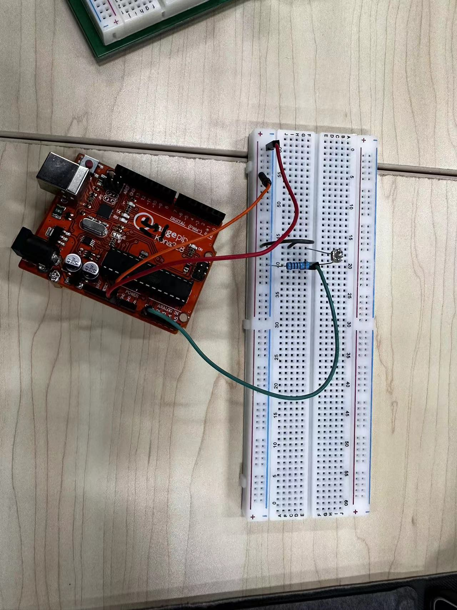
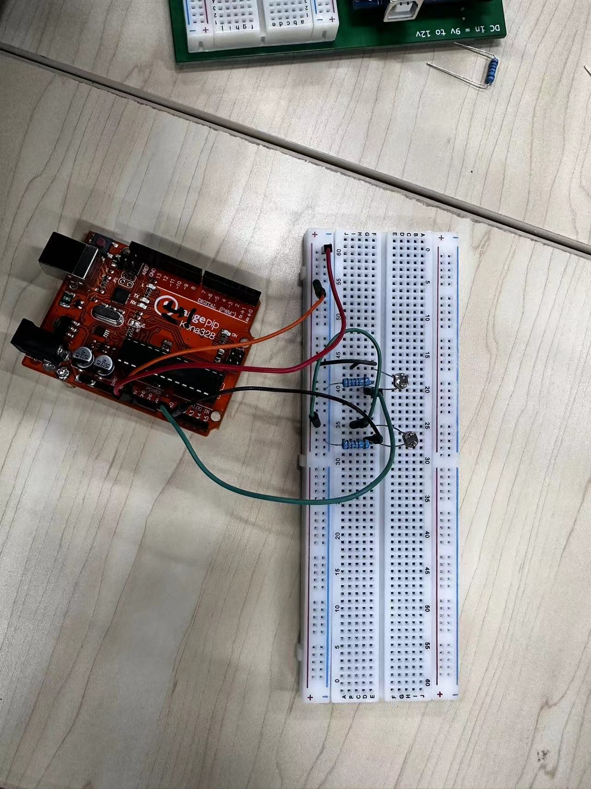
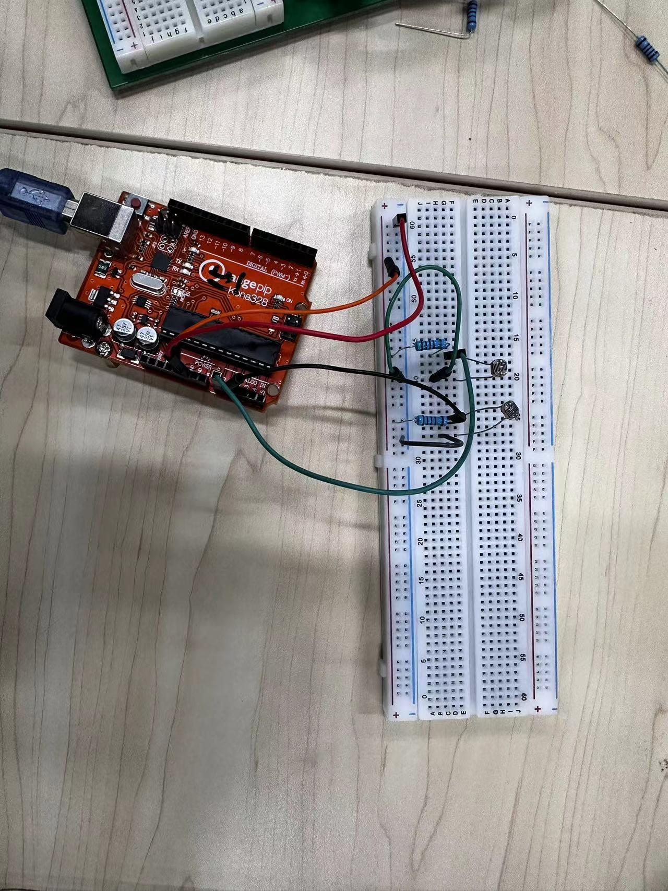
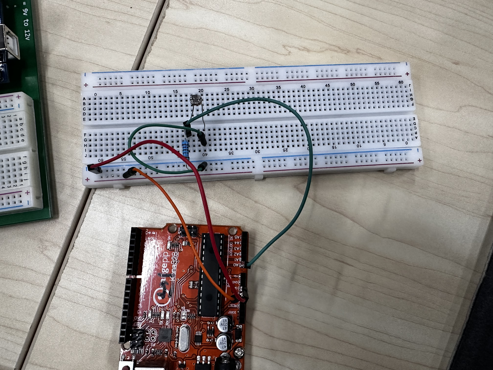
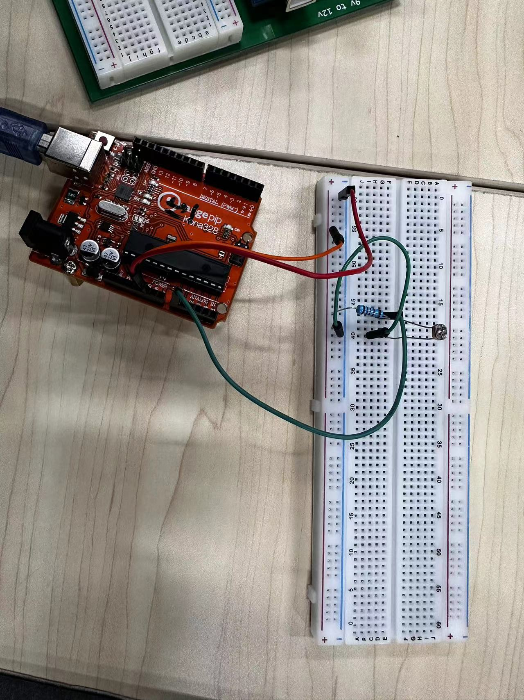

# <center> Lab1 - Properties of LDR </center>

## 1. LDR在接"电源/地"时的"阻值-时间"变化曲线 [固定电阻阻值: $1k\Omega$]

### 实验过程：
1. 该实验可细分为 **LDR<sub>1</sub>** 接电源，**LDR<sub>1</sub>** 接地，**LDR<sub>2</sub>** 接电源，**LDR<sub>2</sub>** 接地4个子实验。

2. 分别按如图所示进行接线:
<div style="display: flex; justify-content: center">
  <div style="margin-right: 10px;">
    
  </div>
  <div>
    
  </div>
</div>

3. 通过 Arduino IDE 编写程序实现获取模拟引脚 A<sub>0</sub> 上的电压值经过模数转换(ADC)后的数值。其原理如下:  
<center>

Voltage = $
    \frac{V_{A_0}}{1023} \times V_{ref}
$

</center>

&ensp;&ensp;&ensp;&ensp;&ensp;&ensp; 又
<center>

$ V_{A_0}=V_{cc} \times \frac{R_L}{R_F+R_L} $

</center>

&ensp;&ensp;&ensp;&ensp;&ensp;&ensp; 所以
<center>

$ R_L=R_F \times \frac{V_{ref}-V_{A_0}}{V_{A_0}} $

</center>

4. 通过 IDE 的 Serial Monitor 获取到对应的 sensorValue, 具体如下:   
> 光线由强到弱
>> GND_LDR_1:   
    [ 333, 256, 240, 246, 241, 225, 219, 225, 244, 240, 240, 307, 378, 450, 
    475, 508, 544, 584, 627, 660, 687, 712, 754, 773, 802, 817, 878, 1020, 
    1017, 1016, 1022, 1023, 1023, 1023 ]  
> 
>> GND_LDR_2:
    [ 153, 140, 133, 127, 122, 120, 119, 122, 124, 124, 129, 144, 174, 
    195, 221, 261, 303, 312, 343, 379, 397, 433, 464, 493, 537, 572, 592, 
    607, 593, 600, 626, 636, 631, 637, 654, 686, 705, 733, 781, 825, 844, 
    857, 858, 851, 850, 854, 1023, 1023, 1023, 1023, 1023, 1023, 1023 ]

> 光线由弱到强
>> VCC_LDR_1:  
    [ 141, 140, 137, 228, 434, 431, 406, 392, 394, 542, 543, 531, 521, 513, 
    584, 579, 591, 594, 659, 659, 653, 650, 649, 668, 680, 702, 758, 883, 
    822, 930, 949, 952, 960, 994, 1023, 1020, 1023, 1016, 1009, 1015 ]
>
>> VCC_LDR_2:  
    [ 172, 178, 181, 184, 277, 591, 585, 559, 550, 552, 757, 762, 768, 853, 
    853, 845, 846, 902, 897, 892, 885, 909, 911, 913, 914, 915, 913, 913, 
    916, 922, 956, 972, 982, 989, 1005, 1007, 1023, 1023, 1023, 1023 ]
5. "处理数据 & 生成图像" 代码如下:
```python
import numpy as np
import matplotlib.pyplot as plt

R = 1000.0
Vref = 5.0

adc_values_01 = np.array([ 
    333, 256, 240, 246, 241, 225, 219, 225, 244, 240, 240, 307, 378, 450, 
    475, 508, 544, 584, 627, 660, 687, 712, 754, 773, 802, 817, 878, 1020, 
    1017, 1016, 1022, 1023, 1023, 1023 
])

voltage_values_01 = adc_values_01 / 1023.0 * Vref
resistance_values_01 = R * ((Vref - voltage_values_01) / voltage_values_01)

x_values_01 = np.arange(len(adc_values_01))

poly_degree = 6
poly_coeffs_01 = np.polyfit(x_values_01, resistance_values_01, poly_degree)
poly_func_01 = np.poly1d(poly_coeffs_01)

x_dense_01 = np.linspace(x_values_01.min(), x_values_01.max(), 300)
y_dense_01 = poly_func_01(x_dense_01)

plt.figure(figsize=(8, 5))
plt.plot(x_values_01, resistance_values_01, 'ro', label="Data 01")
plt.plot(x_dense_01, y_dense_01, 'r-', label=f"Fit 01 (Degree {poly_degree})")

plt.xlabel("Light Intensity")
plt.ylabel("Resistance")
plt.title("LDR Sensor Resistance Readings")
plt.grid(True)
plt.legend()

plt.savefig("./Photos/Chart/GDN_LDR_01.png", dpi=1200)

plt.show()
```
6. 生成图像如下:
<div style="display: flex; flex-direction: column; align-items: center;">
  <div style="display: flex; justify-content: center; margin-bottom: 10px;">
    <div style="margin-right: 10px;">
      
    </div>
    <div>
      
    </div>
  </div>
  <div style="display: flex; justify-content: center;">
    <div style="margin-right: 10px;">
      
    </div>
    <div>
      
    </div>
  </div>
</div>

## 2. 两个LDR同时接"电源/地"时的"阻值-时间"变化曲线 [固定电阻阻值: $1k\Omega$]

### 实验过程:
1. 该实验可细分为 **LDR<sub>1</sub> & LDR<sub>2</sub>** 同时接地，**LDR<sub>1</sub> & LDR<sub>2</sub>** 同时接电源2个子实验。

2. 分别按如图所示进行接线:
<div style="display: flex; justify-content: center">
  <div style="margin-right: 10px;">
    
  </div>
  <div>
    
  </div>
</div>

3. 通过 Arduino IDE 编写程序实现获取模拟引脚 A<sub>0</sub> & A<sub>1</sub> 上的电压值经过模数转换(ADC)后的数值。
4. 通过 IDE 的 Serial Monitor 获取到对应的 sensorValue1 和 sensorValue2, 具体如下:  
> 光线从 LDR<sub>1</sub> 向 LDR<sub>2</sub> 扫过
>> VCC_LDR_1:  
    [ 664, 753, 840, 889, 925, 973, 1015, 1023, 1023, 1023, 1023, 1023, 1023, 
    1023, 997, 919, 780, 693, 655, 631, 620, 617, 623, 602, 593, 598 ]
> 
>> VCC_LDR_2:  
    [ 458, 484, 530, 557, 585, 619, 647, 730, 783, 830, 881, 941, 987, 1020, 
    1019, 987, 942, 822, 723, 618, 528, 511, 512, 519, 433, 429, 433 ]

> 光线从 LDR<sub>1</sub> 向 LDR<sub>2</sub> 扫过
>> GND_LDR_1:
    [ 878, 784, 756, 697, 664, 622, 548, 473, 418, 410, 430, 476, 521, 590, 
    727, 802, 828, 843, 844, 842, 837, 863 ]
> 
>> GND_LDR_2:
    [ 1023, 975, 958, 926, 900, 870, 820, 739, 649, 610, 605, 615, 641, 695, 
    832, 964, 988, 1003, 1004, 1004, 998, 1023 ]
5. "处理数据 & 生成图像" 代码如下:
```python {.line-numbers}
import numpy as np
import matplotlib.pyplot as plt

R = 1000.0
Vref = 5.0

adc_values_01 = np.array([
    664, 753, 840, 889, 925, 973, 1015, 1023, 1023, 1023, 1023,
    1023, 1023, 1023, 997, 919, 780, 693, 655, 631, 620, 617,
    623, 602, 593, 598
])
adc_values_02 = np.array([
    458, 484, 530, 557, 585, 619, 647, 730, 783, 830, 881,
    941, 987, 1020, 1019, 987, 942, 822, 723, 618, 528, 511,
    512, 519, 433, 429, 433
])

voltage_values_01 = adc_values_01 / 1023.0 * Vref
voltage_values_02 = adc_values_02 / 1023.0 * Vref

resistance_values_01 = R * ((Vref - voltage_values_01) / voltage_values_01)
resistance_values_02 = R * ((Vref - voltage_values_02) / voltage_values_02)

x_values_01 = np.arange(len(adc_values_01))
x_values_02 = np.arange(len(adc_values_02))

poly_degree = 6
poly_coeffs_01 = np.polyfit(x_values_01, resistance_values_01, poly_degree)
poly_coeffs_02 = np.polyfit(x_values_02, resistance_values_02, poly_degree)

poly_func_01 = np.poly1d(poly_coeffs_01)
poly_func_02 = np.poly1d(poly_coeffs_02)


x_dense_01 = np.linspace(x_values_01.min(), x_values_01.max(), 300)
x_dense_02 = np.linspace(x_values_02.min(), x_values_02.max(), 300)

y_dense_01 = poly_func_01(x_dense_01)
y_dense_02 = poly_func_02(x_dense_02)


plt.figure(figsize=(8, 5))

# 绘制原始数据点
plt.plot(x_values_01, resistance_values_01, 'ro', label="Data 01")
plt.plot(x_values_02, resistance_values_02, 'go', label="Data 02")

# 绘制多项式拟合曲线
plt.plot(x_dense_01, y_dense_01, 'r-', label=f"Fit 01 (Degree {poly_degree})")
plt.plot(x_dense_02, y_dense_02, 'g-', label=f"Fit 02 (Degree {poly_degree})")

plt.xlabel("Light Intensity")
plt.ylabel("Resistance")
plt.title("LDR Sensor Resistance Readings")
plt.grid(True)
plt.legend()

plt.savefig("./Photos/Chart/VCC_LDR_Both.png", dpi=1200)

plt.show()
```
6. 生成图像如下:
<div style="display: flex; justify-content: center">
  <div style="margin-right: 10px;">
    
  </div>
  <div>
    
  </div>
</div>

## 3. LDR在接"电源/地"时的"阻值-时间"变化曲线 [固定电阻阻值: $270\Omega$]

### 实验过程:
1. 按如图所示进行接线:
<div style="display: flex; justify-content: center">
    
</div>

3. 通过 Arduino IDE 编写程序实现获取模拟引脚 A<sub>0</sub> 上的电压值经过模数转换(ADC)后的数值。
4. 通过 IDE 的 Serial Monitor 获取到对应的 sensorValue, 具体如下:  
> 光线从暗变亮
>> VCC_LDR_1:
    [ 1023, 1023, 1023, 1023, 1023, 1023, 1023, 1023, 1023, 1023, 1023, 1023,
    892, 880, 887, 788, 796, 716, 723, 731, 717, 680, 678, 600, 656, 619, 560,
    541, 508, 480, 456, 437, 399, 432, 492, 524, 831, 1023 ]    
5. "处理数据 & 生成图像" 代码如下:
```python
import numpy as np
import matplotlib.pyplot as plt

R = 270.0
Vref = 5.0

adc_values_01 = np.array([ 
    1023, 1023, 1023, 1023, 1023, 1023, 1023, 1023, 1023, 1023, 
    1023, 1023, 892, 880, 887, 788, 796, 716, 723, 731, 717, 680, 678, 600, 656, 619, 
    560, 541, 508, 480, 456, 437, 399, 432, 492, 524, 831, 1023 
])

voltage_values_01 = adc_values_01 / 1023.0 * Vref
resistance_values_01 = R * ((Vref - voltage_values_01) / voltage_values_01)

x_values_01 = np.arange(len(adc_values_01))

poly_degree = 6
poly_coeffs_01 = np.polyfit(x_values_01, resistance_values_01, poly_degree)
poly_func_01 = np.poly1d(poly_coeffs_01)

x_dense_01 = np.linspace(x_values_01.min(), x_values_01.max(), 300)
y_dense_01 = poly_func_01(x_dense_01)

plt.figure(figsize=(8, 5))
plt.plot(x_values_01, resistance_values_01, 'ro', label="Data 01")
plt.plot(x_dense_01, y_dense_01, 'r-', label=f"Fit 01 (Degree {poly_degree})")

plt.xlabel("Light Intensity")
plt.ylabel("Resistance")
plt.title("LDR Sensor Resistance Readings")
plt.grid(True)
plt.legend()

plt.savefig("./Photos/Chart/VCC_270_LDR.png", dpi=1200)

plt.show()
```
6. 生成图像如下:
<div style="display: flex; justify-content: center">
    
</div>

## 4. LDR在接"电源/地"时的"阻值-时间"变化曲线 [固定电阻阻值: $10k\Omega$]

### 实验过程:
1. 按如图所示进行接线:
<div style="display: flex; justify-content: center">
    
</div>

3. 通过 Arduino IDE 编写程序实现获取模拟引脚 A<sub>0</sub> 上的电压值经过模数转换(ADC)后的数值。
4. 通过 IDE 的 Serial Monitor 获取到对应的 sensorValue, 具体如下:  
> 光线从暗变亮
>> VCC_LDR_1:
    [ 606, 605, 618, 651, 212, 206, 206, 206, 71, 68, 66, 63, 60, 61, 42, 43, 42,
    33, 33, 33, 33, 31, 31, 31, 31, 32, 32, 38, 48]
5. "处理数据 & 生成图像" 代码如下:
```python
import numpy as np
import matplotlib.pyplot as plt

R = 10000.0
Vref = 5.0

adc_values_01 = np.array([ 
    606, 605, 618, 651, 212, 206, 206, 206, 71, 68, 66, 63, 60, 61, 42, 43, 42,
    33, 33, 33, 33, 31, 31, 31, 31, 32, 32, 38, 48
])

voltage_values_01 = adc_values_01 / 1023.0 * Vref
resistance_values_01 = R * ((Vref - voltage_values_01) / voltage_values_01)

x_values_01 = np.arange(len(adc_values_01))

poly_degree = 6
poly_coeffs_01 = np.polyfit(x_values_01, resistance_values_01, poly_degree)
poly_func_01 = np.poly1d(poly_coeffs_01)

x_dense_01 = np.linspace(x_values_01.min(), x_values_01.max(), 300)
y_dense_01 = poly_func_01(x_dense_01)

plt.figure(figsize=(8, 5))
plt.plot(x_values_01, resistance_values_01, 'ro', label="Data 01")
plt.plot(x_dense_01, y_dense_01, 'r-', label=f"Fit 01 (Degree {poly_degree})")

plt.xlabel("Light Intensity")
plt.ylabel("Resistance")
plt.title("LDR Sensor Resistance Readings")
plt.grid(True)
plt.legend()

plt.savefig("./Photos/Chart/VCC_10k_LDR.png", dpi=1200)

plt.show()
```
6. 生成图像如下:
<div style="display: flex; justify-content: center">
    
</div>