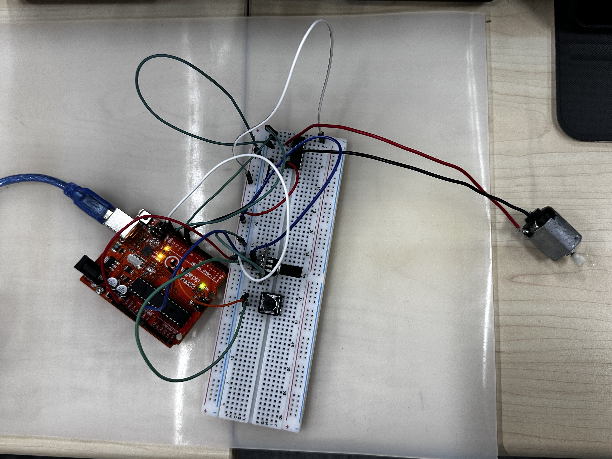
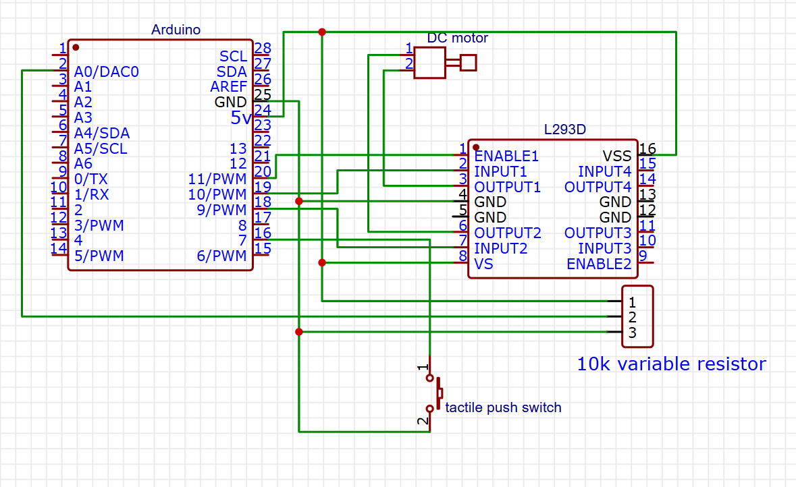
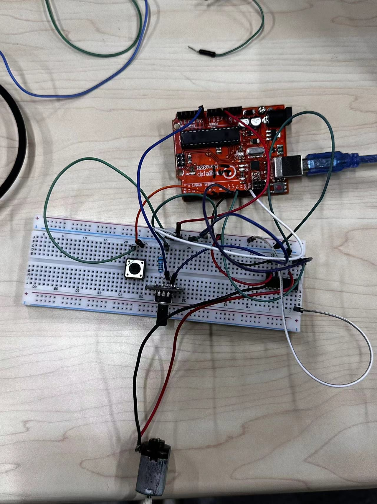
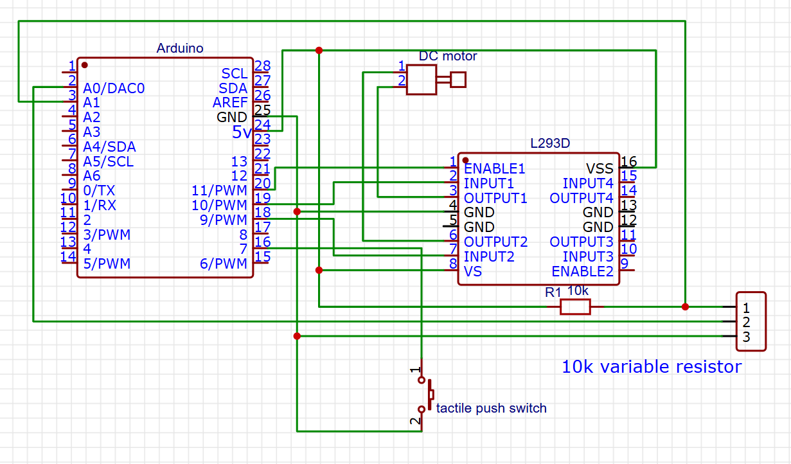

<div align="center">
  <h1>Lab2 - Motor Drive</h1>
</div>

## 1. 实现 Motor 转动

### 实验过程：
1. 该实验在于将电机，滑动变阻器和开关在通过 $ L293D $ 芯片连接驱动电机转动。

2. 按照如图所示进行接线:
<p align="center">
***actual***
  <br>
  
  <br> <br>
  ***JLC***
  <br>
  
</p>

3. 通过 Arduino IDE 编写程序实现驱动 motor 转动，具体代码如下：
```cpp
int enablePin = 11;
int in1Pin = 10;
int in2Pin = 9;
int switchPin = 7;
int potPin = 0;

void setup() {
  // put your setup code here, to run once:
  pinMode(in1Pin, OUTPUT);
  pinMode(in2Pin, OUTPUT);
  pinMode(enablePin, OUTPUT);
  pinMode(switchPin, INPUT_PULLUP);
}

void loop() {
  // put your main code here, to run repeatedly:
  int speed = analogRead(potPin) / 4;
  boolean reverse = digitalRead(switchPin);
  setMotor(speed, reverse);
}

void setMotor(int speed, boolean reverse) {
  analogWrite(enablePin, speed);
  digitalWrite(in1Pin, !reverse);
  digitalWrite(in2Pin, reverse);
}
```


## 2. Motor 旋转时的 “转速-滑动变阻器阻值” 变化曲线 [固定电阻阻值: $10k\Omega$]

### 实验过程：
1. 该实验在于获取电机实时转速以及通过串联一个固定电阻通过分压计算实现获取滑动变阻器的电阻值。其下可细分为在 $FULL\ PWM $ <sup>①</sup>、
$ 3/4\ PWM $ <sup>②</sup>、$ 2/4\ PWM $ <sup>③</sup>、$ 1/4\ PWM $ <sup>④</sup> 四个子实验。

2. 按照如图所示接线
<p align="center">
  ***actual***
  <br>
  
  <br> <br>
  ***JLC***
  <br>
  
</p>

3. Arduino IDE 代码如下：
```cpp
int enablePin = 11;
int in1Pin = 10;
int in2Pin = 9;
int switchPin = 7;
int potPin = 0;
int fixedR = 10000;
int VCC = 5;

void setup() {
  // put your setup code here, to run once:
  pinMode(in1Pin, OUTPUT);
  pinMode(in2Pin, OUTPUT);
  pinMode(enablePin, OUTPUT);
  pinMode(switchPin, INPUT_PULLUP);
  Serial.begin(9600);
}

void loop() {
  // put your main code here, to run repeatedly:
  int speed = (analogRead(potPin) / 4) * 1 / 4;
  Serial.print("Speed: ");
  Serial.print(speed);
  Serial.print(";\t");

  boolean reverse = digitalRead(switchPin);
  Serial.print("Sequence: ");

  if(reverse == 1) {
    Serial.print("Clockwise");
  } else {
    Serial.print("Counter-Clockwise");
  }  
  Serial.print(";\t");

  setMotor(speed, reverse);

  int sensorValue_A0 = analogRead(A0);
  float Vout = (sensorValue_A0 / 1023.0) * VCC;
  float Rpot = fixedR * ((VCC - Vout) / Vout);
  Serial.print("POT-LIN: ");
  Serial.println(sensorValue_A0);

  delay(1);
  delay(500);
}

void setMotor(int speed, boolean reverse) {
  analogWrite(enablePin, speed);
  digitalWrite(in1Pin, !reverse);
  digitalWrite(in2Pin, reverse);
}
```

3. 通过 IDE 的 Serial Monitor 获取模拟引脚 A<sub>0</sub> 上的电压值经过模数转换(ADC)后的数值除 4 后得到其实时转速，及其对应的滑动变阻器的电阻值，具体如下：
> 4/4 PWM
>> speed: 
    [ 136, 136, 134, 135, 135, 135, 137, 144, 153, 155, 160, 163, 166, 169, 174,
    176, 179, 182, 183, 184, 185, 187, 188, 190, 191, 193, 194, 196, 197, 196,
    196, 198, 198, 200, 200, 202, 202, 203, 202, 205, 206, 206, 209, 208, 209,
    211, 216, 216, 214, 213, 216, 214, 216 ]  
> 
>> pot_lin:
    [ 527, 527, 524, 525, 525, 524, 532, 564, 597, 611, 629, 635, 641, 651, 669,
    671, 691, 699, 693, 707, 715, 723, 720, 735, 743, 748, 748, 751, 767, 760,
    770, 778, 787, 782, 801, 802, 805, 808, 813, 822, 816, 825, 823, 844, 847,
    851, 862, 866, 868, 865, 863, 861, 856 ] 

> 3/4 PWM
>> speed:
    [ 100, 100, 100, 99, 100, 105, 110, 114, 117, 121, 123, 126, 128, 129, 132,
    133, 135, 136, 137, 140, 141, 143, 144, 146, 148, 150, 150, 152, 153, 155,
    156, 157, 158, 159, 161, 162, 162, 163, 162, 162, 159, 159, 160 ]  
>
>> pot_lin:
    [ 522, 520, 520, 520, 521, 547, 576, 602, 620, 637, 649, 661, 676, 681, 695,
    703, 707, 711, 714, 725, 730, 739, 745, 750, 759, 770, 770, 773, 790, 804,
    802, 815, 820, 828, 835, 844, 851, 858, 858, 858, 844, 845, 850 ]

> 2/4 PWM
>> speed:
    [ 53, 57, 54, 57, 58, 60, 61, 63, 63, 63, 69, 72, 75, 79, 81, 82, 85, 87, 89,
    91, 93, 95, 96, 97, 99, 101, 102, 102, 104, 104, 105, 106, 107, 108, 109,
    109, 109, 109, 109, 110, 110, 109, 108 ]  
> 
>> pot_lin:
    [ 539, 529, 542, 538, 533, 552, 419, 416, 403, 395, 441, 467, 499, 532, 565,
    578, 601, 620, 639, 655, 675, 695, 707, 725, 743, 750, 751, 759, 765, 767,
    775, 781, 786, 795, 799, 805, 806, 806, 807, 805, 819, 837, 839 ]  

> 1/4 PWM
>> speed:
    [ 31, 31, 31, 31, 31, 33, 34, 36, 37, 38, 39, 40, 41, 42, 43, 44, 45, 46,
    47, 47, 48, 49, 50, 50, 51, 51, 52, 53, 53, 54, 54, 55, 55, 54, 54, 54 ]
>
>> pot_lin:
    [ 450, 462, 474, 490, 508, 531, 559, 580, 602, 614, 630, 646, 665, 684, 698,
    715, 724, 736, 750, 762, 775, 785, 797, 806, 816, 825, 836, 844, 853, 861,
    870, 875, 876, 861, 863, 870 ]  

5. "处理数据 & 生成图像" 代码如下：
```python
import numpy as np
import mlx.core as mx
import matplotlib.pyplot as plt

speed = [
    136, 136, 134, 135, 135, 135, 137, 144, 153, 155, 160, 163, 166, 169, 174,
    176, 179, 182, 183, 184, 185, 187, 188, 190, 191, 193, 194, 196, 197, 196,
    196, 198, 198, 200, 200, 202, 202, 203, 202, 205, 206, 206, 209, 208, 209,
    211, 216, 216, 214, 213, 216, 214, 216
]
pot_lin = [
    527, 527, 524, 525, 525, 524, 532, 564, 597, 611, 629, 635, 641, 651, 669,
    671, 691, 699, 693, 707, 715, 723, 720, 735, 743, 748, 748, 751, 767, 760,
    770, 778, 787, 782, 801, 802, 805, 808, 813, 822, 816, 825, 823, 844, 847,
    851, 862, 866, 868, 865, 863, 861, 856
]

speed = mx.array(speed)
pot_lin = mx.array(pot_lin)

poly_degree = 6
poly_coeffs = np.polyfit(speed, pot_lin, poly_degree)
poly_func = np.poly1d(poly_coeffs)

speed_dense = mx.linspace(speed.min(), speed.max(), 300)
pot_lin_dense = poly_func(speed_dense)

plt.figure(figsize=(10, 6))
plt.plot(speed, pot_lin, 'ro', label='Original Data')
plt.plot(speed_dense, pot_lin_dense, 'b-', label=f"Fitting Curve (Degree-{poly_degree})")

plt.xlabel("Speed / (rad / s)")
plt.ylabel(r"POT-LIN / $\Omega$")
plt.title('Speed - POT-LIN')
plt.grid(True)
plt.legend()

plt.savefig("./Photos/Chart/424_MOTOR_CLOCKWISE.png", dpi=1200)

plt.show()
```

6. 生成图像如下：
<p align="center">
  
  
  <br>
  
  
</p>


## 3. 实现 Motor “顺时针&逆时针” 旋转
### 实验过程：
1. 该实验在于通过改变 $ in1 $ 和 $ in2 $ 的电平高低来实现电机的正转/反转。

2. 其余步骤同1。代码同2。
3. 通过 IDE 的 Serial Monitor 获取到对应的参数，具体如下：
> Clockwise
>>  Speed: 136;    Sequence: Clockwise;    POT-LIN: 527  
    Speed: 136;    Sequence: Clockwise;    POT-LIN: 527   
    Speed: 134;    Sequence: Clockwise;    POT-LIN: 524  
    ...

> Counter-Clockwise
>>  Speed: 132;    Sequence: Counter-Clockwise;    POT-LIN: 526  
    Speed: 136;    Sequence: Counter-Clockwise;    POT-LIN: 526  
    Speed: 135;    Sequence: Counter-Clockwise;    POT-LIN: 525  
    ...