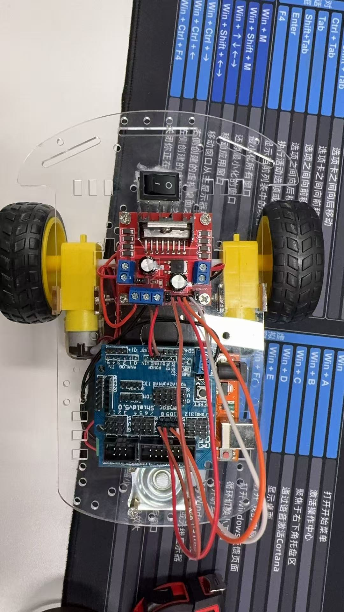
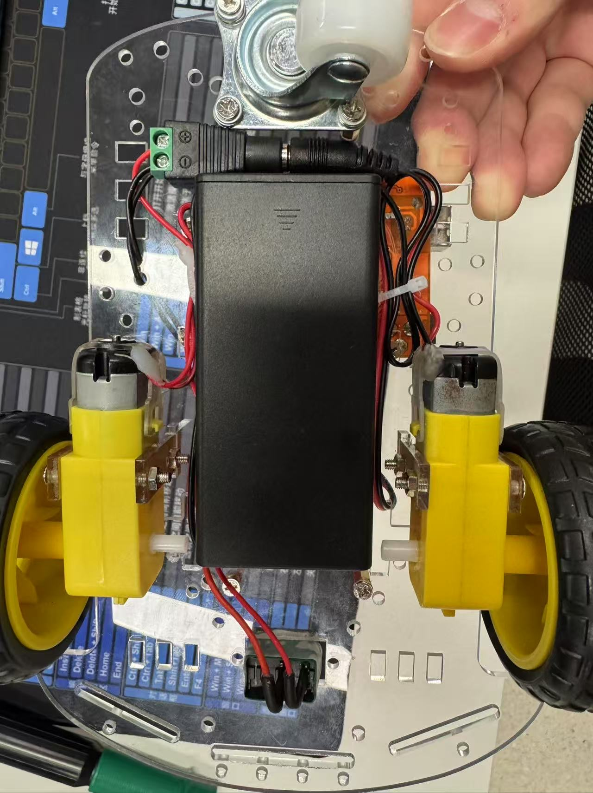
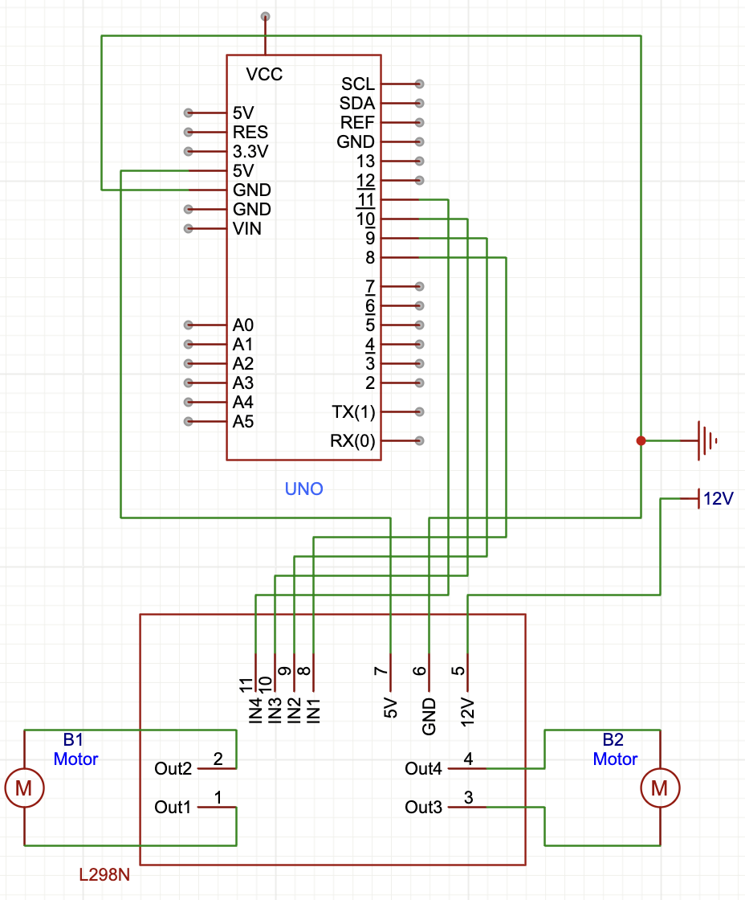
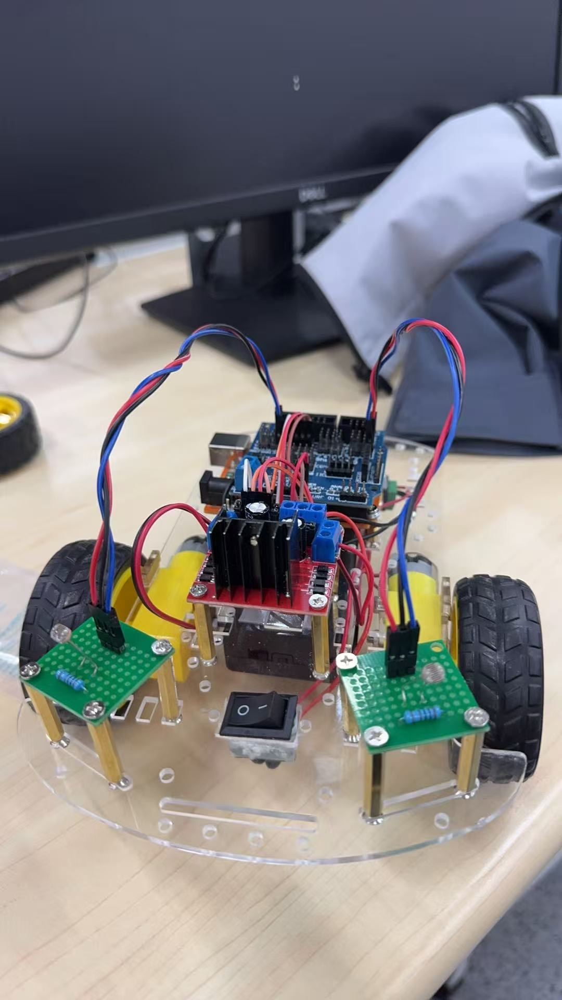
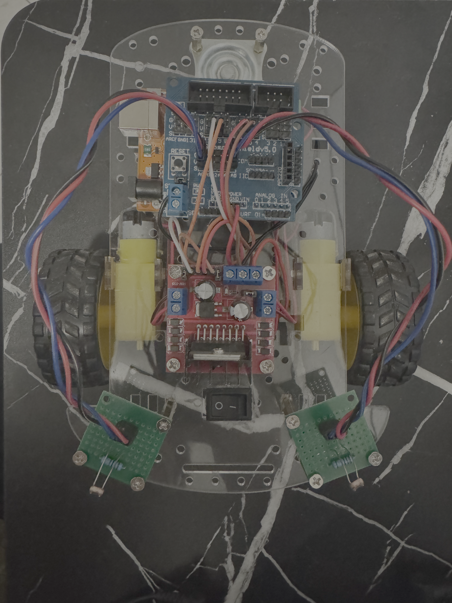
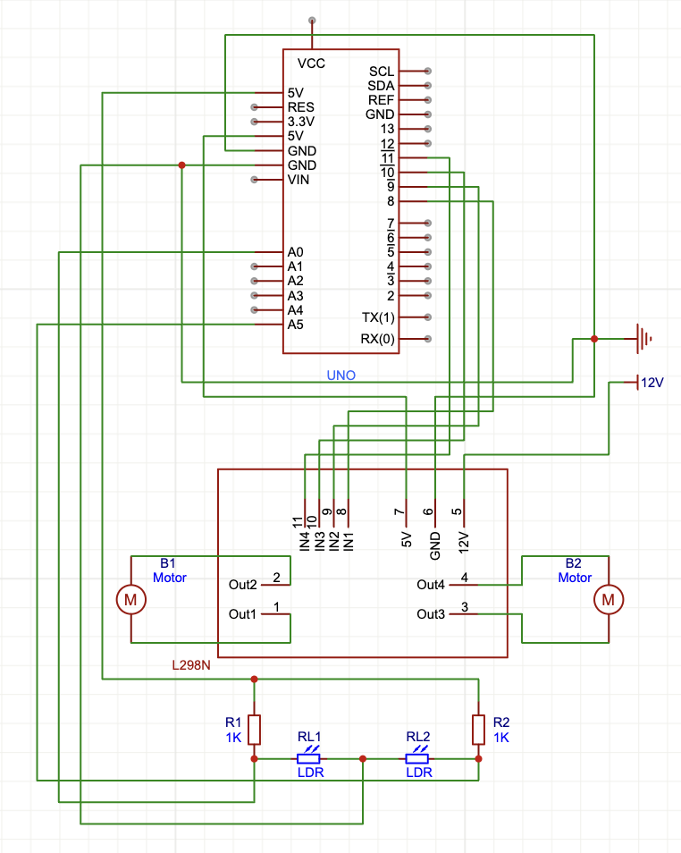

<div align="center">
  <h1>Lab3 - Car Drive</h1>
</div>

## 1. 实现小车**前进/后退**

### 实验过程：
1. 按照如下图示接线:
<p align="center">
  ***actual***
  <br>
  
  
  <br>
  ***JLC***
  <br>
  
</p>

2. Arduino IDE代码:
```cpp {.line-numbers}
/* 四引脚 mode */
int in1Pin = 5;
int in2Pin = 6;
int in3Pin = 9;
int in4Pin = 10;

int baseSpeed = 150;

// fluctuating rate
float leftComp = 1.00;
float rightComp = 1.00;

void setup() {
  // put your setup code here, to run once:
  pinMode(in1Pin, OUTPUT);
  pinMode(in2Pin, OUTPUT);
  pinMode(in3Pin, OUTPUT);
  pinMode(in4Pin, OUTPUT);
  
  // Initialize
  analogWrite(in1Pin, 0);
  analogWrite(in4Pin, 0);
  digitalWrite(in2Pin, LOW);
  digitalWrite(in3Pin, LOW);
}

void loop() {
  // put your main code here, to run repeatedly:
  int leftSpeed = baseSpeed * leftComp;
  int rightSpeed = baseSpeed * rightComp;

  boolean reverse = 0;
  setLeft(reverse, leftSpeed);
  setRight(reverse, rightSpeed);
}

// Left Wheel CONTROL
void setLeft(boolean reverse, int speed) {
  speed = constrain(speed, 0, 255);
  digitalWrite(in2Pin, reverse);
  analogWrite(in1Pin, speed);
}

// Right Wheel CONTROL
void setRight(boolean reverse, int speed) {
  speed = constrain(speed, 0, 255);
  digitalWrite(in3Pin, !reverse);
  analogWrite(in4Pin, 255 - speed);
}
```

## 2. 实现小车**寻光**行驶

### 实验过程：
1. 按照如下图示接线:
<p align="center">
  ***actual***
  <br>
  
  
  <br>
  ***JLC***
  <br>
  
</p>

2. Arduino IDE代码:
```c++ {.line-numbers}
/* 四引脚 mode */
int in1Pin = 5;
int in2Pin = 6;
int in3Pin = 9;
int in4Pin = 10;

int base_Speed = 120;
int decelerated_Speed = 110;
int accelerated_Speed = 135;

// fluctuating rate
float leftComp = 1.00;
float rightComp = 1.00;

void setup() {
  // put your setup code here, to run once:
  Serial.begin(9600);
  pinMode(in1Pin, OUTPUT);
  pinMode(in2Pin, OUTPUT);
  pinMode(in3Pin, OUTPUT);
  pinMode(in4Pin, OUTPUT);

  // Initialize
  analogWrite(in1Pin, 0);
  analogWrite(in4Pin, 0);
  digitalWrite(in2Pin, LOW);
  digitalWrite(in3Pin, LOW);
}

void loop() {
  // put your main code here, to run repeatedly:
  boolean reverse = 0;

  int sensorValue_LEFT = analogRead(A5);
  int sensorValue_RIGHT = analogRead(A0);
  int GAP = abs(sensorValue_LEFT - sensorValue_RIGHT);

  Serial.print("LEFT: ");
  Serial.print(sensorValue_LEFT);
  Serial.print("\t RIGHT: ");
  Serial.print(sensorValue_RIGHT);
  Serial.print("\t GAP: ");
  Serial.println(GAP);

  Turn(reverse, sensorValue_LEFT, sensorValue_RIGHT, GAP);

  delay(10); // read arguments every 10ms
}

// Left Wheel CONTROL
void setLeft(boolean reverse, int speed) {
  speed = constrain(speed, 0, 255);
  digitalWrite(in2Pin, reverse);
  analogWrite(in1Pin, speed);
}

// Right Wheel CONTROL
void setRight(boolean reverse, int speed) {
  speed = constrain(speed, 0, 255);
  digitalWrite(in3Pin, !reverse);
  analogWrite(in4in, 255 - speed);
}

// car Turn CONTROL - LIGHT Toward
void Turn(boolean reverse, int Left, int Right, int Gap) {
  if(Gap >= 70) {
    // Turn LEFT
    if(Left < Right) {
      setLeft(reverse, decelerated_Speed * leftComp);
      setRight(reverse, accelerated_Speed * rightComp);
    } 
    // Turn RIGHT
    if(Right < Left) {
      setLeft(reverse, accelerated_Speed * leftComp);
      setRight(reverse, decelerated_Speed * rightComp);
    }
  } else if(Gap >= 10 && Gap < 70){
    // Go FORWARD
    setLeft(reverse, base_Speed * leftComp);
    setRight(reverse, base_Speed * rightComp);
  } else {
    // STOP
    setLeft(reverse, 0);
    setRight(reverse, 0);
  }
}
```