

  <h1>Lab4 - Line Tracking</h1>

## 1. ADC 值随 IR 距离变化时的 "value - distance" 曲线

### 实验过程: 
1. 检测 IR 距离白纸每 0.5cm 其 ADC 值的变化，从 0.5 ~ 5cm 共 10 组数据。
2. 实验结果如下:
> From Stanley
>> [ 33, 37, 42, 48, 59, 65, 294, 560, 765, 895 ]
> 
> From Yilin
>> [ 34, 38, 43, 49, 54, 70, 275, 465, 680, 800 ]
> 
> From Chloe
>> [ 33, 38, 42, 48, 58, 86, 315, 510, 648, 846 ]

3. 绘制图像如下:

  

## 2. IR 检测到不同形式 line 的 7 种状态
### 实验过程: 
1. 检测 IR 在 7 种情况下得到的不同结果。
2. 实验结果如下:

  ***000***
   
  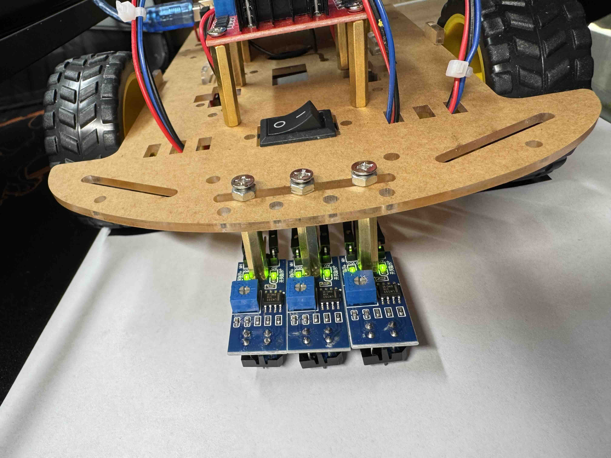
  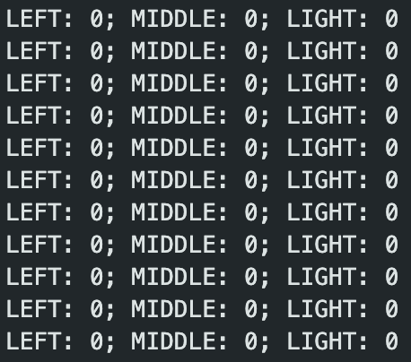
   
  ***001***
   
  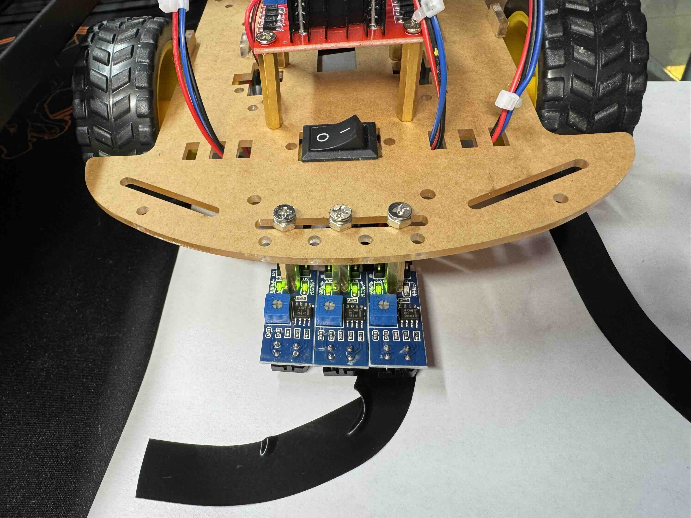
  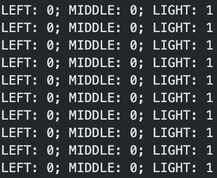
   
  ***010***
   
  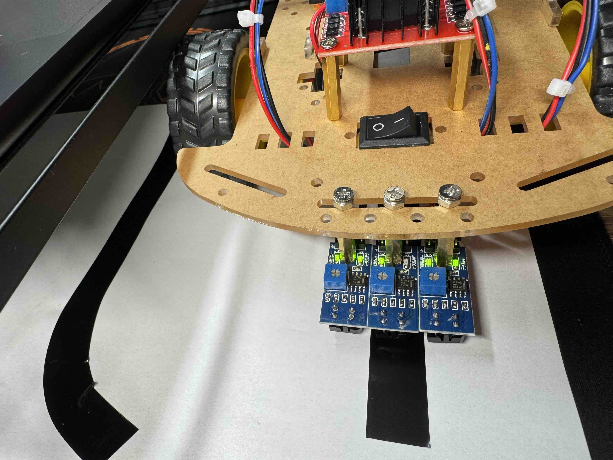
  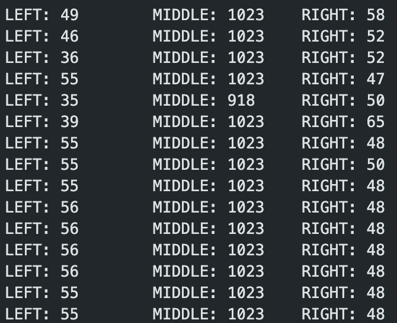
   
  ***011***
   
  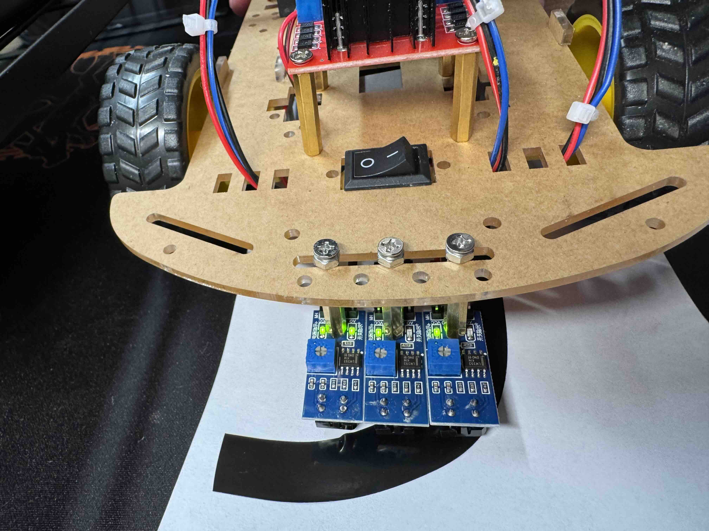
  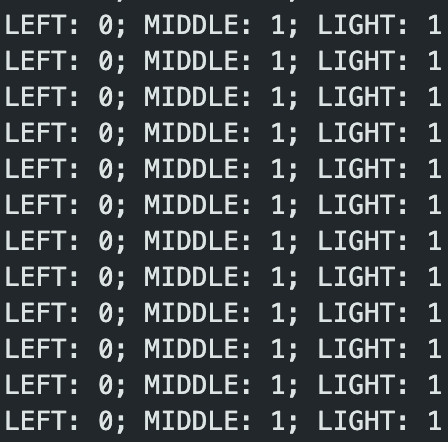
   
  ***100***
   
  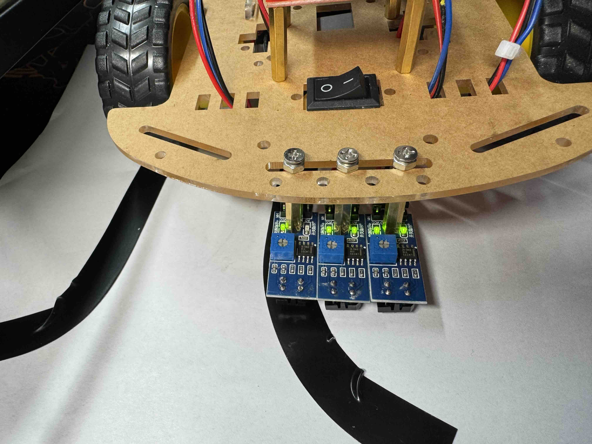
  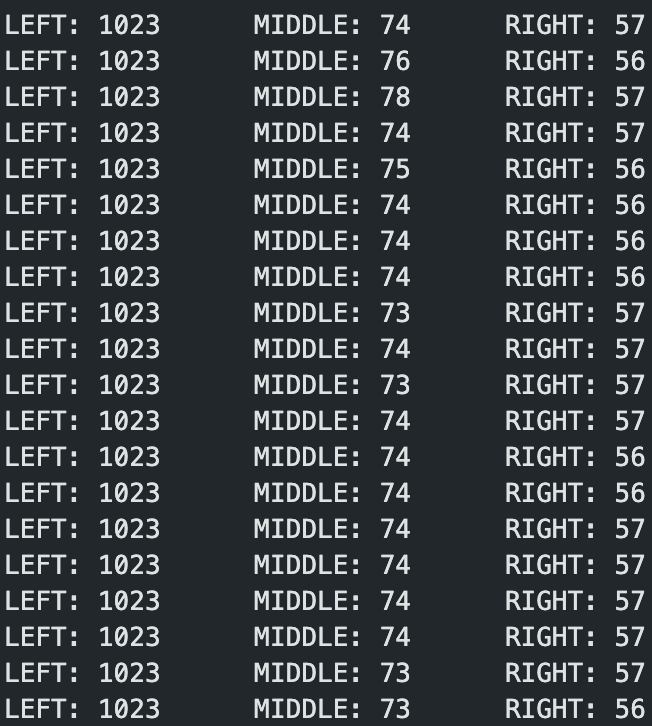
   
  ***110***
   
  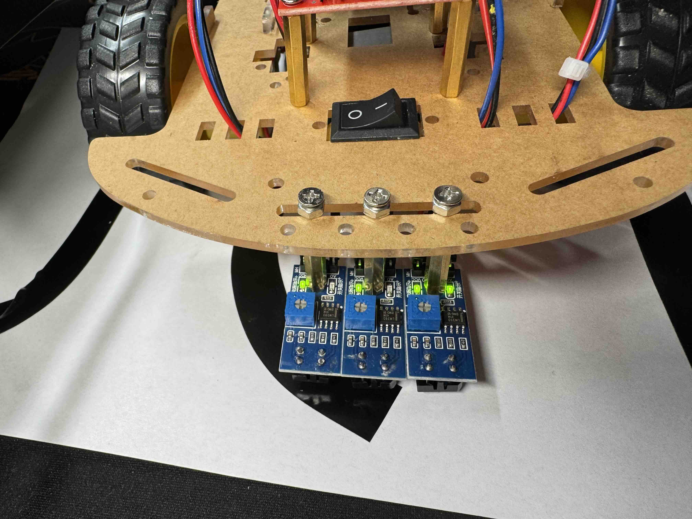
  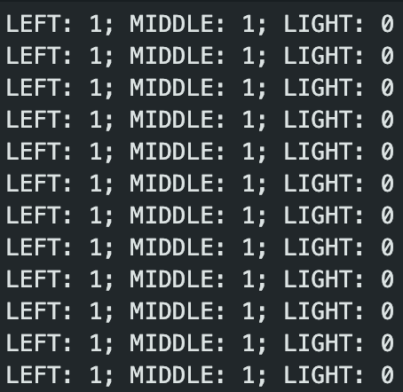
   
  ***111***
   
  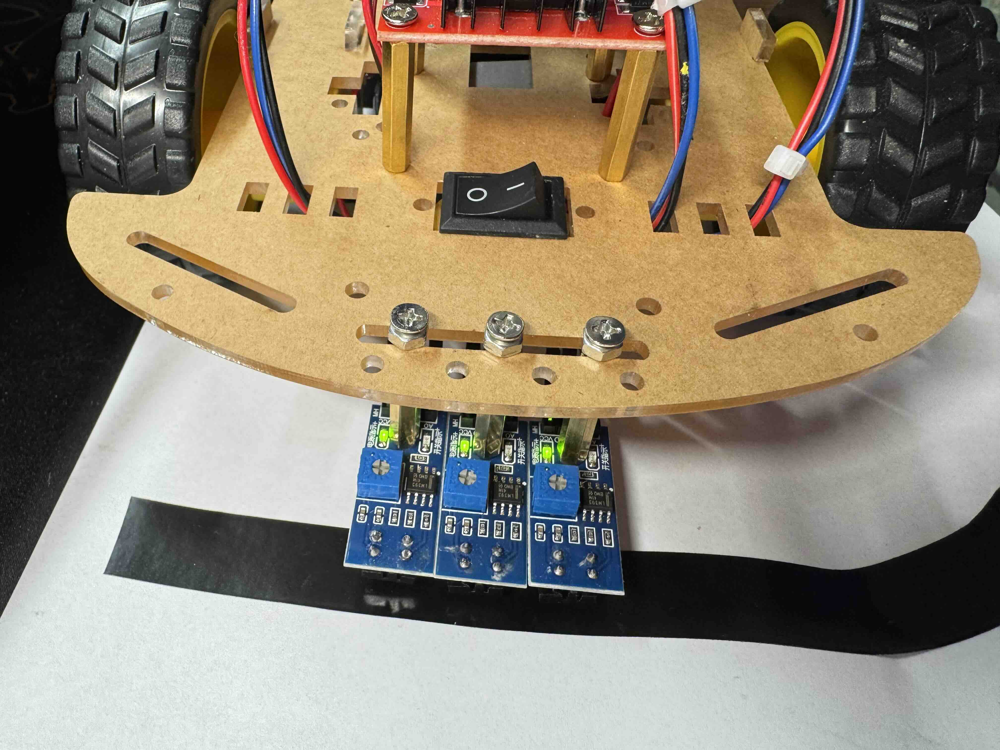
  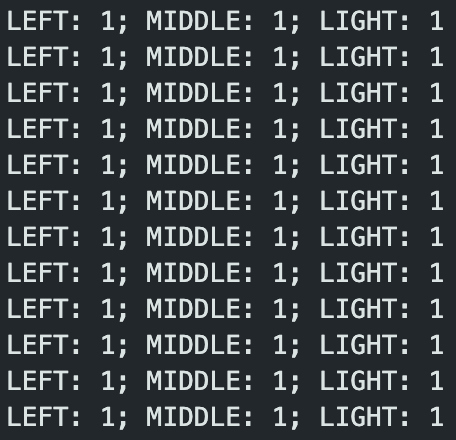
   

