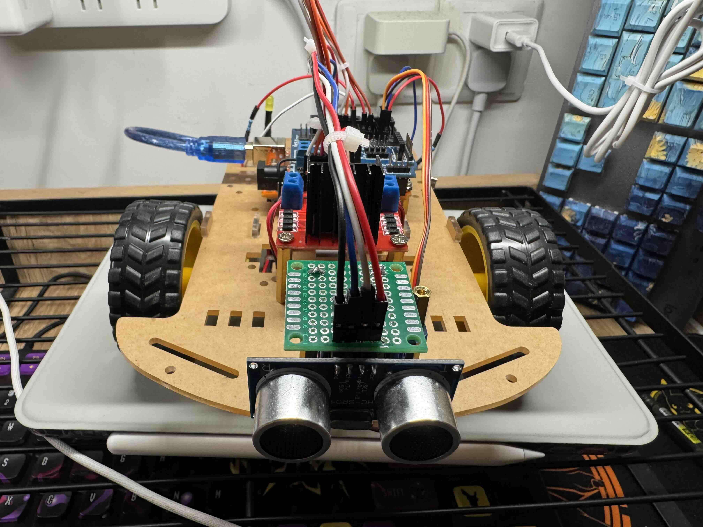
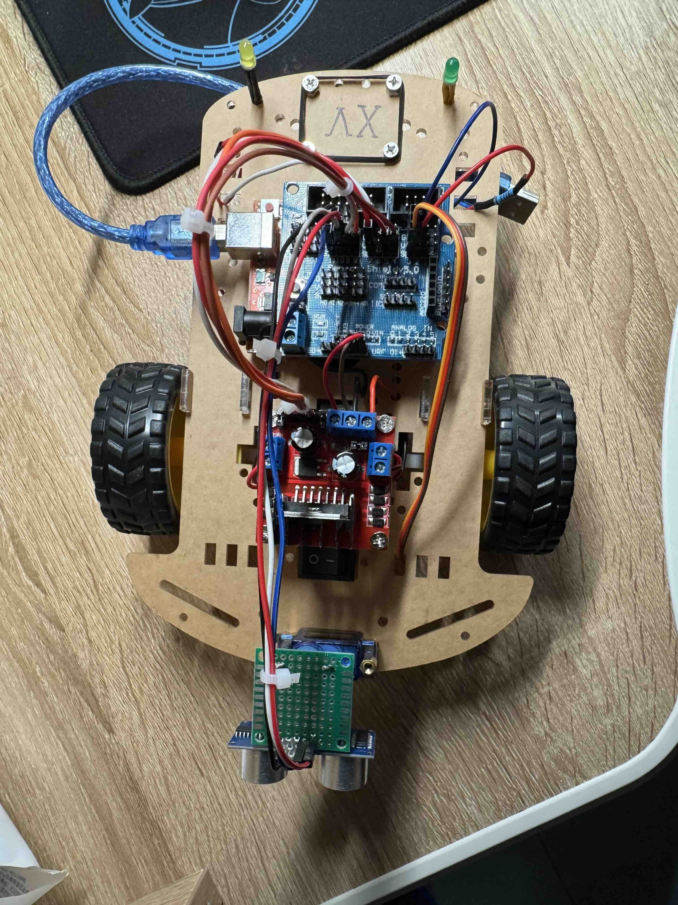
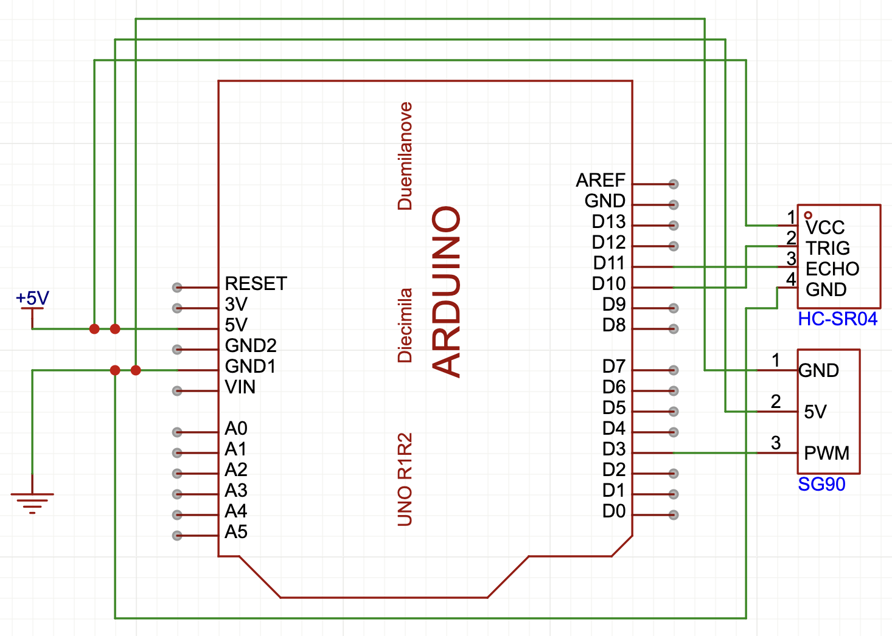

<div align="center">
    <h1>Lab6 - Ultrasonic Distance Detection</h1>
</div>

## HC-SR04 超声波测距搭配 SG90 舵机使用测量的雷达图
### 1. 原理 
1. HC-SR04 超声波测距原理:  
详见 [# HC-SR04 超声波测距](https://projecthub.arduino.cc/Isaac100/getting-started-with-the-hc-sr04-ultrasonic-sensor-7cabe1)
2. SG90 舵机原理:  
详见 [# SG90 舵机](https://blog.csdn.net/weixin_42645653/article/details/112210095)

### 2. 实验过程
### 3. 实物图
<p align="center">
  
  
</p>

### 4. 电路图
<p align="center">
  
</p>

### 5. 测量数据
> 0cm:
>> ```0cm_data_01```: (详见 [# 0cm_DATA_01](./DataProcessing/0cm/0cm_data_01.xlsx))  
>> Angle: 135°; Distance: 4.39 cm  
>> Angle: 134°; Distance: 16.43 cm   
>> ...  
>> Angle: 46°; Distance: 45.93 cm  
>> Angle: 45°; Distance: 3.41 cm
>
>> ```0cm_data_02```: (详见 [# 0cm_DATA_02](./DataProcessing/0cm/0cm_data_02.xlsx))  
>> Angle: 135°; Distance: 4.39 cm  
>> Angle: 134°; Distance: 16.41 cm   
>> ...  
>> Angle: 46°; Distance: 45.91 cm  
>> Angle: 45°; Distance: 3.41 cm 
>
>> ```0cm_data_03```: (详见 [# 0cm_DATA_03](./DataProcessing/0cm/0cm_data_03.xlsx))  
>> Angle: 135°; Distance: 4.13 cm  
>> Angle: 134°; Distance: 16.41 cm   
>> ...  
>> Angle: 46°; Distance: 45.62 cm  
>> Angle: 45°; Distance: 3.42 cm

> 40cm:
>> ```40cm_data_01```: (详见 [# 40cm_DATA_01](./DataProcessing/40cm/40cm_data_01.xlsx))  
>> Angle: 135°; Distance: 56.69 cm  
>> Angle: 134°; Distance: 56.61 cm   
>> ...  
>> Angle: 46°; Distance: 183.45 cm  
>> Angle: 45°; Distance: 260.37 cm
>
>> ```40cm_data_02```: (详见 [# 40cm_DATA_02](./DataProcessing/40cm/40cm_data_02.xlsx))  
>> Angle: 135°; Distance: 56.63 cm  
>> Angle: 134°; Distance: 56.63 cm   
>> ...  
>> Angle: 46°; Distance: 138.02 cm  
>> Angle: 45°; Distance: 209.69 cm 
>
>> ```40cm_data_03```: (详见 [# 40cm_DATA_03](./DataProcessing/40cm/40cm_data_03.xlsx))  
>> Angle: 135°; Distance: 56.23 cm  
>> Angle: 134°; Distance: 56.51 cm   
>> ...  
>> Angle: 46°; Distance: 83.4 cm  
>> Angle: 45°; Distance: 209.7 cm

> 80cm:
>> ```80cm_data_01```: (详见 [# 80cm_DATA_01](./DataProcessing/80cm/80cm_data_01.xlsx))
>
>> ```80cm_data_02```: (详见 [# 80cm_DATA_02](./DataProcessing/80cm/80cm_data_02.xlsx))
>
>> ```80cm_data_03```: (详见 [# 80cm_DATA_03](./DataProcessing/80cm/80cm_data_03.xlsx))

> 120cm:
>> ```120cm_data_01```: (详见 [# 120cm_DATA_01](./DataProcessing/120cm/120cm_data_01.xlsx))
>
>> ```120cm_data_02```: (详见 [# 120cm_DATA_02](./DataProcessing/120cm/120cm_data_02.xlsx))
>
>> ```120cm_data_03```: (详见 [# 120cm_DATA_03](./DataProcessing/120cm/120cm_data_03.xlsx))  

> 160cm: ...

> 200cm: ...

> 240cm: ...

> 280cm: ...

> 320cm: ...  

> 360cm: ...

> 400cm: ...

### 6. 三组数据取平均值后数据
详见 [# Average_DATA](./DataAverage)

### 7. “距离 - 角度” 扇形雷达图
<p align="center">
  
</p>

### 8. 0 ~ 400cm 每 40cm 划分的 “距离 - 角度” 扇形雷达图
<p align="center">
  
  
  
  
  
  <br>
  
  
  
  
  
  
</p>

### 9. 0 ~ 400cm 每 40cm 划分的分布热力图
<p align="center">
  
</p>

### 10. 附录: 代码
1. Arduino IDE Code  
详见 [# Arduino IDE](./distanceDetect.cpp)
2. 原始数据通过pandas库提取到excel自动化脚本  
详见 [# DataExtraction](./DataExtraction.py)
3. 基于excel数据通过三次数据取平均的自动化脚本  
详见 [# DataAverage](./DataAverage.py)
4. Code of 黑白雷达测距图  
详见 [# Black&White Ladar](./Black&White.py)
5. Code of "0 ~ 400cm 每 40cm 划分的 '距离 - 角度' 扇形雷达图"  
详见 [# GraphPer10](./GraphGenerate.py)
6. Code of 热力图
详见 [# Heatmap](./HeatmapGenerate.py)